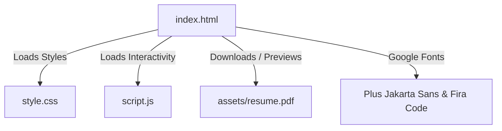

# Praveen S — Professional Personal Portfolio Website

A complete, modern, high-performance, and mobile-responsive personal portfolio website for **Praveen S**, an aspiring AI/ML and Software Developer pursuing B.E. Computer Science and Engineering (AI & ML) at Sudharsan Engineering College (2023–2027), Trichy, Tamil Nadu, India.

Built strictly using **HTML5**, **CSS3**, and **Vanilla JavaScript** with zero external framework dependencies (no React, Bootstrap, or Tailwind CSS).

---

## 📁 Project File Structure / திட்ட கோப்பு கட்டமைப்பு

```text
praveen-portfolio/
├── index.html          # Semantic HTML5 page layout & content
├── style.css           # Premium dark theme with emerald green accents
├── script.js           # Client-side validation, navigation & interactivity
├── README.md           # Documentation & deployment guide (English & தமிழ்)
└── assets/
    └── resume.pdf      # Downloadable PDF resume file
```

---

## 🌟 Key Features

1. **Modern Dark Theme with Emerald Accents**:
   - Sleek developer aesthetic with glassmorphism (`backdrop-filter: blur(14px)`), smooth glowing borders, and CSS illustrations.
2. **Honest Skill Representation**:
   - Clean category cards (Core Programming, AI/NLP Technologies, Tools, Spoken Languages) without fabricated progress bar percentages.
3. **Featured Projects**:
   - **WaVisio — AI Visual Learning System**: Featured flagship AI project utilizing Whisper, spaCy, Hugging Face, and PyQt5.
   - **Hotel Management Website**: Editable full-stack sample with placeholder GitHub & demo links.
   - **E-Commerce Website**: Editable full-stack sample with placeholder GitHub & demo links.
   - **Student Marks Prediction (ML)**: Explicitly identified as a roadmap/concept idea.
4. **Experience & Certifications**:
   - Internships: CodeBind Technologies (Web Development) & Samcore Technologies (Cloud Computing).
   - Certifications: NPTEL (Cloud Computing) & One Roadmap Skill (Data Analyst - Sept 2026).
5. **Resume Download & Preview**:
   - Direct download and new-tab preview linking to `assets/resume.pdf`.
6. **Interactive Contact Form**:
   - Client-side validation for full name, email format, subject, and message.
   - Automatically prepares a pre-filled `mailto:` draft.
   - Includes one-click copy email button with tooltip feedback.
7. **Mobile Responsiveness**:
   - Smooth slide-in mobile navigation menu with escape key and outside-click dismissal.
   - Zero horizontal overflow across all screen sizes.

---

## 🛠️ How Files Connect / கோப்புகள் எவ்வாறு இணைகின்றன



- **`index.html`** acts as the central hub. It links `style.css` in the `<head>` and `script.js` before `</body>`.
- **`style.css`** provides all styles, colors, layouts, and CSS animations.
- **`script.js`** handles scroll events, mobile drawer menu, active link scrollspy, and form validation.
- **`assets/resume.pdf`** is referenced in the Resume section via `<a href="assets/resume.pdf" download="Praveen_S_Resume.pdf">`.

---

## 🚀 Step-by-Step Instructions (English)

### 1. Opening the Project in VS Code
1. Open **Visual Studio Code**.
2. Click **File > Open Folder...** and select `d:\Praveen-website` (or `praveen-portfolio`).
3. Verify that `index.html`, `style.css`, `script.js`, and `assets/resume.pdf` are visible in the left sidebar.

### 2. Testing Locally
- **Method A (Double-click)**: Open file explorer, navigate to the folder, and double-click `index.html`. It opens directly in Chrome, Edge, or Firefox.
- **Method B (VS Code Live Server — Recommended)**:
  1. In VS Code, open the Extensions tab (`Ctrl + Shift + X`).
  2. Search for **Live Server** (by Ritwick Dey) and click **Install**.
  3. Right-click on `index.html` and select **"Open with Live Server"**.
  4. The site will launch at `http://127.0.0.1:5500/index.html`.

### 3. Updating Your Resume (PDF)
1. Export your latest resume from Word, Canva, or Google Docs as a `.pdf` file.
2. Name the file exactly **`resume.pdf`**.
3. Move or copy this file into the `assets/` folder, replacing the current file.
4. Refresh your website. The "Download Resume" and "Preview" buttons will immediately serve your new PDF!

### 4. Customizing Placeholders
- **GitHub Profile**: Search for `https://github.com/your-username` in `index.html` and update it with your real GitHub URL.
- **Project Repositories**: Update the sample repository URLs for the Hotel Management and E-Commerce projects.

### 5. Uploading to GitHub
1. Open terminal inside the project directory:
   ```bash
   git init
   git add .
   git commit -m "Initial commit of Praveen S portfolio website"
   ```
2. Create a new repository on [GitHub](https://github.com/new) named `praveen-portfolio`.
3. Link and push your code:
   ```bash
   git branch -M main
   git remote add origin https://github.com/<your-username>/praveen-portfolio.git
   git push -u origin main
   ```

### 6. Free Deployment
#### Option A: GitHub Pages
1. Go to your GitHub repository > **Settings** > **Pages** (under Code and automation).
2. Under **Build and deployment > Source**, select **Deploy from a branch**.
3. Select **Branch: `main`** and folder **`/(root)`**, then click **Save**.
4. In 1–2 minutes, your website is live at `https://<your-username>.github.io/praveen-portfolio/`.

#### Option B: Vercel
1. Sign in to [Vercel](https://vercel.com) using your GitHub account.
2. Click **"Add New Project"** > import your `praveen-portfolio` repository.
3. Click **"Deploy"**. Vercel will instantly publish your site with a free fast CDN URL.

---

## 🇮🇳 படி படியான வழிகாட்டி (தமிழ் விளக்கம்)

### 1. VS Code-ல் இந்த திட்டத்தை திறப்பது எப்படி?
1. **Visual Studio Code** செயலியைத் திறக்கவும்.
2. மெனுவில் **File > Open Folder...** கிளிக் செய்து உங்கள் திட்டக் கோப்புறையைத் தேர்ந்தெடுக்கவும்.
3. இடதுபுறத்தில் `index.html`, `style.css`, `script.js` மற்றும் `assets/resume.pdf` உள்ளதை உறுதிப்படுத்திக் கொள்ளவும்.

### 2. கணினியில் Local-ஆக இயக்கி பார்ப்பது எப்படி?
- **முறை 1**: File Manager-ல் `index.html` கோப்பை இரட்டை கிளிக் (Double-click) செய்தால், அது உலாவி (Chrome/Edge)-ல் உடனே திறக்கும்.
- **முறை 2 (Live Server)**:
  - VS Code Extensions-ல் சென்று **Live Server** என்பதை நிறுவிக்கொள்ளவும்.
  - `index.html` மீது Right-click செய்து **"Open with Live Server"** என்பதைத் தேர்ந்தெடுக்கவும்.

### 3. உங்கள் புதிய Resume PDF-ஐ மாற்றுவது எப்படி?
1. உங்கள் புதிய Resume-ஐ PDF வடிவத்தில் சேமிக்கவும்.
2. அதன் பெயரை **`resume.pdf`** என்று வைக்கவும்.
3. அதை இந்த திட்டத்தின் `assets/` கோப்புறையினுள் நகலெடுத்து (Copy) மாற்றவும்.
4. வலைத்தளத்தில் உள்ள "Download Resume" பொத்தான் தானாகவே உங்கள் புதிய Resume-ஐ பதிவிறக்கும்!

### 4. GitHub-ல் பதிவேற்றம் செய்வது எப்படி?
```bash
git init
git add .
git commit -m "My Portfolio Website"
git branch -M main
git remote add origin https://github.com/<your-username>/praveen-portfolio.git
git push -u origin main
```

### 5. இணையத்தில் இலவசமாக வெளியிடுவது (GitHub Pages):
1. உங்கள் GitHub Repository பக்கத்தில் **Settings** செல்லவும்.
2. இடதுபுற மெனுவில் உள்ள **Pages** என்பதை கிளிக் செய்யவும்.
3. Branch என்பதை **main** என அமைத்து **Save** செய்யவும்.
4. சில நிமிடங்களில் உங்கள் தளம் இணையத்தில் நேரலையாக இயங்கும் (`https://<username>.github.io/praveen-portfolio/`).

---

## 👨‍💻 Author & Contact

**Praveen S**  
*Aspiring AI/ML & Software Developer*  
- **College**: Sudharsan Engineering College (B.E. CSE - AI & ML, 2023–2027)  
- **Location**: Trichy, Tamil Nadu, India  
- **Email**: [praveen03122005@gmail.com](mailto:praveen03122005@gmail.com)  
- **LinkedIn**: [linkedin.com/in/praveen-s-36728028b](https://linkedin.com/in/praveen-s-36728028b)
